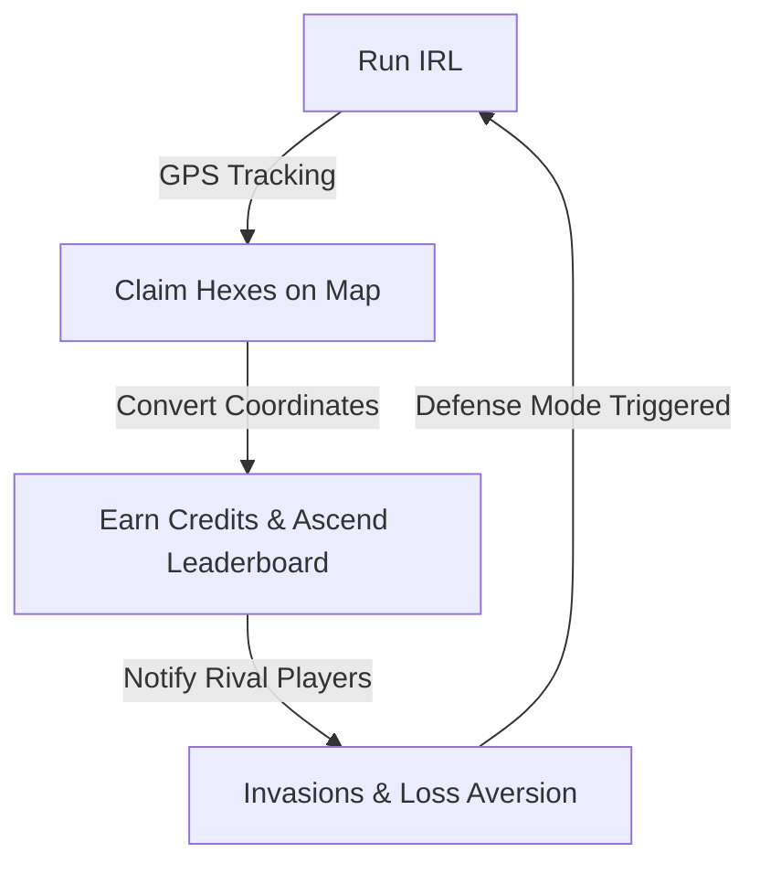

# TerritoryRun — Overall Project Study & Concept Study

## 🎯 Executive Overview & Pitch Deck

TerritoryRun is a real-world, multiplayer, territory-control game powered by physical movement (GPS-tracked running). It sits at the intersection of **gamified fitness, social competition, and real-world maps**.

> **The Hook:** You run IRL. Your path becomes territory. Others invade it. You fight back. Repeat.
> 
> Think **Pokémon GO × Risk × Strava** — with none of the bloat and all of the psychological pull.

---

## 1. Product Vision

Fitness applications (like Strava or Nike Run Club) do an excellent job of tracking stats but often fail to provide ongoing, external motivation for casual runners. On the flip side, location-based games (like Pokémon GO) often encourage passive play (walking, driving slowly) and lack a competitive ownership loop.

TerritoryRun solves this by converting physical exercise into strategic dominance. By mapping GPS points to a global hexagonal grid, we create a dynamic, living battlefield where every runner is a warlord claiming territory in their local neighborhood.

### The Core Loop



| Step | What Happens | Why It Matters |
{style="margin-top: 10px;"}
|---|---|---|
| **1. Run** | User starts a GPS-tracked run | Physical action required — no passive driving/spoofing |
| **2. Claim** | GPS path converts to [Uber H3](https://h3geo.org) hex grid claims | Visual ownership appears immediately on the map |
| **3. Earn** | Credits earned per hex claimed | Tangible economy reward for movement |
| **4. Defend** | Others invade your hexes | Loss aversion triggers revenge runs |
| **5. Compete** | Leaderboard rank updates live | Social hierarchy creates a status game |
| **6. Repeat** | Decay + Invasions force ongoing engagement | Game state evolves even when you are offline |

---

## 2. Market Positioning & Uniqueness

TerritoryRun occupies a unique market quadrant. It requires the high-exertion athletic commitment of Strava but pairs it with the spatial capture mechanics of territorial board games.

```
                  High Athletic Exertion
                           ▲
                           │  [TerritoryRun]
                           │  (High athletic + Competitive map)
                           │
       [Strava]            │
       (Pure fitness stats)│
                           │
◄──────────────────────────┼──────────────────────────► Spatial Game
  Passive/No Map Control   │   [Pokémon GO / Ingress]  Mechanics
                           │   (Walk/Drive + Portal control)
                           │
                           │
                           ▼
                  Low Athletic Exertion
```

### Competitive Grid
| Feature | TerritoryRun | Strava | Pokémon GO | Ingress |
|---|---|---|---|---|
| **Primary Exertion** | Running/Jogging | Running/Cycling | Walking/Sitting | Walking/Driving |
| **Territory Mechanic** | Hex-grid ownership | None (Segments only) | Gym control | Portal links |
| **Social Map** | Live color overlays | Post-run map feeds | Static POI | Faction links |
| **Economy** | Credits + Daily Reset | None | PokeCoins (Pay-to-win) | AP / Items |
| **Decay Engine** | Yes (-2% daily) | No | No (Gym decay only) | Yes (Portal decay) |
| **Blockchain Anchor** | Yes (Sepolia) | No | No | No |

---

## 3. Target Audience & Player Personas

Our product is built for four distinct customer segments:

### Player Profiles
*   **Lapsed Runners (25-35 age):** People who used to run consistently but stopped because pure fitness tracking became boring. They need gamified, external motivation to lace up their shoes.
*   **Competitive Athletes:** Active Strava users who want actual stakes. "Someone just stole my home turf" is a far stronger trigger than "Someone took my local Segment PR."
*   **Mobile Gamers (Location-Based):** Players of Pokémon GO or Ingress who want a deeper, physically demanding game with zero pay-to-win mechanisms.
*   **Urban Explorers:** Runners who enjoy discovering new routes. The territory map acts as a permanent visual log of everywhere they have conquered.

### Behavioral Personas

We map our core features to four Bartle-inspired player personas:

```
                  COMPETITIVE (Act on Players)
                            ▲
                            │  [The Rival]
                            │  - City Leaderboards
        [The Defender]      │  - Duel history
        - Invasion alerts   │
        - Home turf defense │
◄───────────────────────────┼───────────────────────────► COLLABORATIVE
  (Act on World)            │  (Interact with Players)  (Interact with World)
        [The Expander]      │  [The Social Player]
        - Max hex count     │  - City Chat
        - Heatmap tracking  │  - RAG bot advice
                            │
                            ▼
                  EXPLORATORY (Act on World)
```

---

## 4. Behavioral Psychology: The Engagement Engine

TerritoryRun is built on three core cognitive biases to drive daily active usage (DAU):

### 1. Loss Aversion (Kahneman & Tversky)
Psychological research shows that the pain of losing something is **twice as powerful** as the pleasure of gaining it. 
*   *Application:* When player A runs through player B's territory, B receives an immediate push notification: `⚠️ [Player A] just invaded 5 of your hexes in [Neighborhood]! You lost 120 potential credits.`
*   *Result:* This triggers an immediate urge to reclaim the territory, creating an organic re-engagement loop.

### 2. The IKEA Effect & Ownership Bias
People overvalue things they have invested labor into.
*   *Application:* The map is painted in the runner's chosen custom color (e.g., `#00FF88` Neon Green). Seeing their neighborhood physically colored in their identity creates a sense of digital property.
*   *Result:* Users are highly protective of their territories because they spent real calories claiming them.

### 3. Social Proof & Status (The Leaderboard Hierarchy)
Runners compete for dominance of a city.
*   *Application:* The top 1 player in the city unlocks the **Prestige White (`#FFFFFF`)** color. Senders in chat rooms have their names rendered in their live territory color.
*   *Result:* Running becomes a visible status symbol. When you speak in the chat, the color of your username proves how much territory you own.

---

## 5. The Anti-Monopoly Loop: The Daily Reset

In traditional territory-control games, early adopters eventually establish a monopoly. New players face an impossible barrier to entry because all territory is locked down. 

TerritoryRun solves this with a **Daily Reset Mechanism**:
*   **Decay:** Hexes decay at **-2% per 24 hours** of inactivity, making static camping unsustainable.
*   **Midnight Sweep:** At **23:59 UTC**, all territory ownership is wiped clean. The map is reset to an unowned, neutral grid.
*   **Bonus Distribution:** The top 10 players on the global leaderboard are awarded permanent bonus credits (e.g., 500 for #1, 300 for #2).
*   **Daily Celebration:** Sockets emit a `daily_reset` event to all active clients, animating the leaderboard updates and clearing the map live.

> [!TIP]
> This creates a daily tournament loop. New users can join on any day and have a 100% equal chance of claiming their neighborhood by morning, while veterans compete to bank permanent credits for their profile stats.
