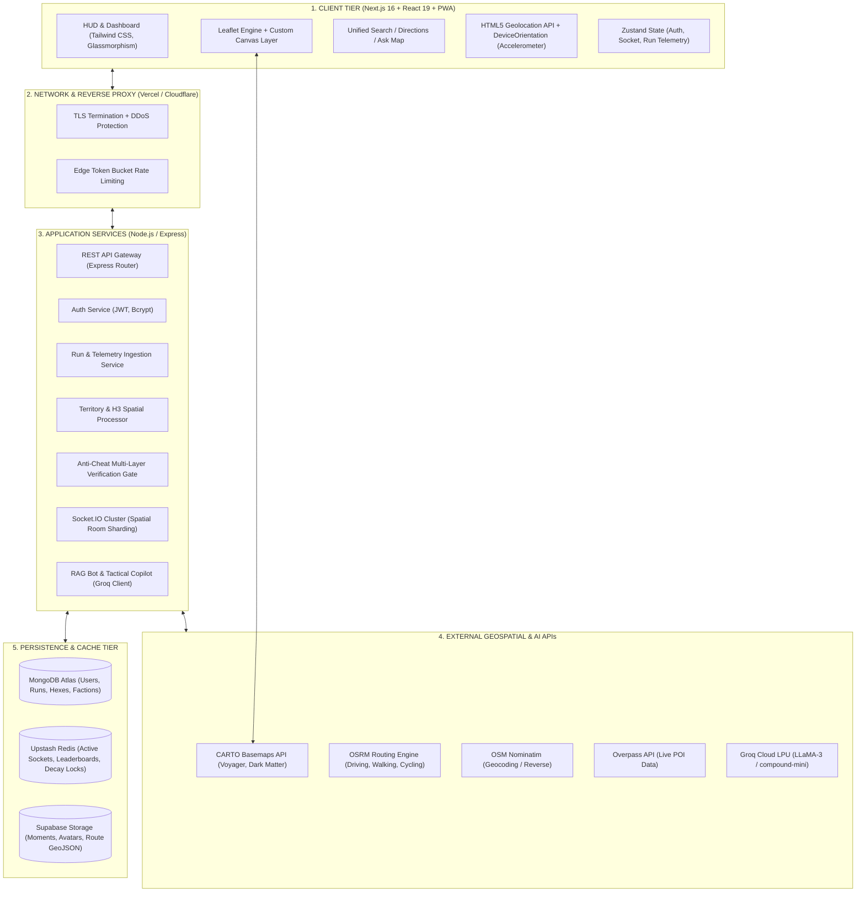

# TerritoryRun — Master End-to-End Technical Interview Guide

> **Document Type:** Production Engineering Whitepaper & Technical Interview Preparation Manual  
> **Project:** TerritoryRun (Real-World Geospatial Multiplayer Fitness & Faction Conquest Engine)  
> **Author/Maintainer:** Full-Stack & Systems Engineering Team  
> **Target Audience:** Technical Interviewers, Lead Engineers, System Architects  

---

## Table of Contents
1. [Executive Overview & Problem Statement](#1-executive-overview--problem-statement)
2. [Complete System Architecture & Topology](#2-complete-system-architecture--topology)
3. [Frontend Engineering (Next.js 16 + React 19)](#3-frontend-engineering-nextjs-16--react-19)
4. [Geospatial Computing Engine (Uber H3 & CARTO)](#4-geospatial-computing-engine-uber-h3--carto)
5. [Real-Time Multiplayer Networking (WebSockets & Spatial Sharding)](#5-real-time-multiplayer-networking-websockets--spatial-sharding)
6. [Backend Services & Modular Monolith Engine](#6-backend-services--modular-monolith-engine)
7. [Database Architecture & Distributed Caching](#7-database-architecture--distributed-caching)
8. [Anti-Cheat Engine & Multi-Sensor Telemetry](#8-anti-cheat-engine--multi-sensor-telemetry)
9. [Geocoding, POI Discovery & OSRM Routing](#9-geocoding-poi-discovery--osrm-routing)
10. [AI Tactical Copilot & "Ask Map" RAG Pipeline](#10-ai-tactical-copilot--ask-map-rag-pipeline)
11. [Web3 & Blockchain Smart Contract Mechanics](#11-web3--blockchain-smart-contract-mechanics)
12. [DevOps, CI/CD, Containerization & V2 Roadmap](#12-devops-cicd-containerization--v2-roadmap)
13. [Exhaustive Technical Interview Q&A (50 Deep-Dive Questions)](#13-exhaustive-technical-interview-qa)

---

## 1. Executive Overview & Problem Statement

### 1.1 The Core Problem
Standard fitness applications (Strava, Nike Run Club, Apple Fitness) treat workouts as isolated telemetry logs. Runners lack real-time intrinsic motivation, collective gamification, and tactical competition. Conversely, location-based games (Pokémon GO, Ingress) require stopping and interacting with screens, making them dangerous or disruptive for sustained cardiovascular exercise.

### 1.2 The TerritoryRun Solution
**TerritoryRun** transforms real-world outdoor running into a continuous, real-time territory conquest strategy game.
* **Hands-Free Telemetry:** Runners run uninterrupted with GPS tracking in their pockets.
* **Spatial Discretization:** The globe is indexed using **Uber H3 hexagonal grid cells (Resolution 9, ~0.1 km² per cell)**.
* **Faction Warfare:** Players join 3 global factions (*Red Vanguard, Blue Syndicate, Green Guardians*) and claim, defend, or invade territories through physical distance traversed.
* **Dynamic Economy & Decay:** Hexagons yield Territory Credits ($TRC$), undergo a daily **2% exponential idle decay**, and feature a 1.5x peak-hour multiplier.
* **Real-Time Multiplayer Radar:** Live runners in the same geographic quadrant are rendered via WebSockets on smooth **CARTO Voyager/Dark vector-raster basemaps**.
* **AI Copilot & Geospatial Engine:** Groq-accelerated LLaMA-3 models parse natural language map searches ("Ask Map") and provide tactical advice without hallucinating real-world POIs.

---

## 2. Complete System Architecture & Topology



---

## 3. Frontend Engineering (Next.js 16 + React 19)

### 3.1 Tech Stack Components
* **Framework:** Next.js 16.1.6 (App Router with Turbopack compilation).
* **Core Library:** React 19 (Server Components, Actions, Transitions, Hooks).
* **State Management:** 
  * `Zustand`: Client-side global stores for Authentication (`authStore`), Active Socket connections (`socketStore`), and live run metrics.
  * `SWR`: Optimistic UI data fetching and stale-while-revalidate polling for social feeds, leaderboards, and user profiles.
* **Styling & Design Tokens:** Tailwind CSS 3.4 + Glassmorphism UI tokens. Theme: Clean pastel game aesthetic (Eggshell base `#F4F7F4`, Forest Green `#2E7D52`, Sage `#A8D5BA`, Lilac `#A594D3`).
* **Animations:** Framer Motion 11 for slide-in panels, bottom sheets, level-up confetti, and HUD gauges.
* **Map Rendering:** Leaflet 1.9 + `react-leaflet`, supplemented with raw HTML5 Canvas rendering for 1,000+ dynamic H3 polygon overlays.

### 3.2 Solving Complex Frontend Challenges

#### A. React Re-Render & Socket Stacking Bug
* **The Problem:** Modifying arrays of runner points via `path.push(newCoord)` retained the underlying array memory reference. React's virtual DOM reconciliation skipped re-rendering Leaflet SVG polylines.
* **The Fix:** Implemented immutable state updates:
  ```typescript
  setActiveRunners(prev => {
    const existing = prev[data.userId];
    const newPath = existing?.path ? [...existing.path, [data.lat, data.lng]] : [[data.lat, data.lng]];
    return {
      ...prev,
      [data.userId]: { ...existing, path: newPath.slice(-100) }
    };
  });
  ```

#### B. CSS Stacking Context Collision on Blur Modals
* **The Problem:** Applying `backdrop-filter: blur(...)` to parent HUD wrappers created an isolated CSS stacking context. Fixed-position modal dialogs (MomentsTray Lightbox) rendered *beneath* sibling map components.
* **The Fix:** Migrated overlays to `createPortal(modalJSX, document.body)` so modals mount to the root DOM hierarchy outside HUD parent contexts.

---

## 4. Geospatial Computing Engine (Uber H3 & CARTO)

### 4.1 Why Uber H3 Discrete Global Grid?
Unlike standard square latitude/longitude grids or Geohashes:
1. **Equal Neighbor Distances:** Hexagons have exactly 6 neighbors, and the distance between the center of any hexagon and all its 6 neighbors is identical. Squares have 8 neighbors with two distinct distance metrics (orthogonal vs. diagonal), creating distortion.
2. **Area Uniformity:** Resolution 9 cells maintain an average area of **0.107 km²** (~107,000 m²), with an average edge length of **174 meters**, which maps to an 800m–1.2km running loop.
3. **Integer Representation:** Every H3 cell is serialized as an ultra-compact 64-bit hexadecimal integer (e.g., `'8928308280fffff'`), allowing $O(1)$ memory lookups, indexing in Redis, and efficient MongoDB B-Trees.

```
       / \
     /     \
    |   H3  |  <--- Resolution 9: ~0.1 km², 174m edge
    |  Cell |       Hexadecimal index: 8928308280fffff
     \     /
       \ /
```

### 4.2 Spatial Formulas Implemented

#### A. Haversine Distance (Great-Circle Distance)
Used for micro-telemetry distance validation between sequential GPS coordinates $(lat_1, lon_1)$ and $(lat_2, lon_2)$:
$$\Delta lat = (lat_2 - lat_1) \cdot \frac{\pi}{180}, \quad \Delta lon = (lon_2 - lon_1) \cdot \frac{\pi}{180}$$
$$a = \sin^2\left(\frac{\Delta lat}{2}\right) + \cos(lat_1 \cdot \frac{\pi}{180}) \cdot \cos(lat_2 \cdot \frac{\pi}{180}) \cdot \sin^2\left(\frac{\Delta lon}{2}\right)$$
$$c = 2 \cdot \arctan2(\sqrt{a}, \sqrt{1 - a})$$
$$Distance = R \cdot c \quad (\text{where } R = 6,371,000 \text{ meters})$$

#### B. Cell Projection & Ring Neighbors
* `latLngToCell(lat, lng, 9)`: Projects continuous WGS84 GPS point coordinates into a discrete discrete Res-9 H3 index.
* `gridDisk(originCell, k)`: Computes all cells within topological distance $k$ for rendering adjacent territory influence and Fog-of-War reveal zones.

### 4.3 CARTO Basemaps & Zero-Watermark Authentication
* Switched to CARTO Voyager and Dark Matter raster-vector basemaps.
* Authenticated URL pattern:
  `https://{s}.basemaps.cartocdn.com/rastertiles/voyager/{z}/{x}/{y}{r}.png?key=${CARTO_API_KEY}`
* Includes subdomain rotation (`abcd`), custom attribution strings, and an automated fallback system.

---

## 5. Real-Time Multiplayer Networking (WebSockets & Spatial Sharding)

### 5.1 Architecture: Spatial Pub/Sub Sharding
Broadcasting thousands of simultaneous runner GPS updates globally creates an $O(N^2)$ network bottleneck. TerritoryRun avoids this by using **H3 Spatial Room Sharding**:

```
Global Runners -> H3 Res 6 Parent Lookup -> Room: "hex_862830800ffffff"
Only clients viewing that parent tile receive high-frequency telemetry.
```

1. **Resolution 6 Parental Rooms:** As a player runs, their Res 9 hex is converted to its Resolution 6 parent (~110 km²).
2. **Socket Room Joining:** The client socket automatically subscribes to `socket.join('hex_' + parentHex)`.
3. **Broadcasting:** Telemetry is emitted only to that parent room:
   ```javascript
   socket.to(`hex_${parentHex}`).emit('live_runner', {
     userId, username, lat, lng, userColor, faction
   });
   ```
4. **Bandwidth Optimization:** Payload serialization strips redundant metadata, compressing coordinate packets to <80 bytes per update.

---

## 6. Backend Services & Modular Monolith Engine

### 6.1 Backend Stack
* **Runtime:** Node.js (v20 LTS), Express framework.
* **Real-time Server:** `socket.io` with CORS security & JWT handshake authentication.
* **Security Middleware:** `helmet`, `cors`, `express-rate-limit`, `mongo-sanitize`.
* **Logging & Telemetry:** `winston` structured logger with daily log file rotation.

### 6.2 Service Decoupling
```
backend/
├── auth-service/        # JWT creation, Bcrypt hashing, password validation
├── run-service/         # Telemetry intake, socket handlers, step matching
├── territory-service/   # H3 index calculation, invasion logic, faction points
├── rag-bot-service/     # Groq API client, context builder, intent extractor
└── config/models.js     # Mongoose schemas (User, Territory, Run, Faction)
```

### 6.3 Core Territory Conquest Logic
When a runner submits a path:
1. Coordinates are converted to unique H3 indices: `Array.from(new Set(coords.map(c => latLngToCell(c.lat, c.lng, 9))))`.
2. For each hexagon:
   * **Unclaimed:** Insert new Territory record with `ownerId = runner.id`, `faction = runner.faction`, `health = 100`. Award **10 Credits**.
   * **Friendly Owned:** Reset decay counter to current timestamp. Health replenished to 100. Award **2 Maintenance Credits**.
   * **Enemy Owned (Invasion):** Deduct invasion damage. If captured, transfer ownership and award **25 Invasion Credits**.
3. **Peak Hour Boost:** If current local time falls between 07:00–09:00 or 17:00–19:00, apply a **1.5x Multiplier** to all earned credits.

---

## 7. Database Architecture & Distributed Caching

### 7.1 MongoDB Atlas Schema Models

#### `User` Schema
```typescript
{
  username: { type: String, required: true, unique: true, index: true },
  email:    { type: String, required: true, unique: true },
  password: { type: String, required: true }, // Bcrypt salted hash
  credits:  { type: Number, default: 0, index: -1 },
  faction:  { type: String, enum: ['red', 'blue', 'green'], default: 'red' },
  color:    { type: String, default: '#A8D5BA' },
  totalDistanceKm: { type: Number, default: 0 },
  totalSteps:      { type: Number, default: 0 },
  unfoggedHexes:   [{ type: String }], // Array of discovered H3 hex strings
  isShadowBanned:  { type: Boolean, default: false }
}
```

#### `Territory` Schema
```typescript
{
  hexId:         { type: String, required: true, unique: true, index: true }, // H3 Res-9
  ownerId:       { type: Schema.Types.ObjectId, ref: 'User', index: true },
  faction:       { type: String, enum: ['red', 'blue', 'green'] },
  health:        { type: Number, default: 100 },
  initialValue:  { type: Number, default: 10 },
  currentValue:  { type: Number, default: 10 },
  lastClaimedAt: { type: Date, default: Date.now },
  lastDecayedAt: { type: Date, default: Date.now }
}
```

#### `Run` Schema
```typescript
{
  userId:      { type: Schema.Types.ObjectId, ref: 'User', required: true, index: true },
  startedAt:   { type: Date, required: true },
  endedAt:     { type: Date },
  status:      { type: String, enum: ['active', 'ended', 'disqualified'], default: 'active' },
  distanceKm:  { type: Number, default: 0 },
  steps:       { type: Number, default: 0 },
  creditsEarned: { type: Number, default: 0 },
  path:        [{ lat: Number, lng: Number, timestamp: Number }],
  claimedHexes: [{ type: String }],
  disqualificationReason: { type: String }
}
```

### 7.2 Territory Compounding Decay Mathematics
Territory values deteriorate when inactive:
$$V(t) = V_0 \times (0.98)^n$$
Where:
* $V_0$ is the initial credit value (e.g. 10 TRC).
* $n$ is the number of continuous days without a run.
* A cron job executes daily at 00:00 UTC, applying updates across all non-refreshed territories. If $V(t) < 1.0$, the territory resets to neutral status (`ownerId = null`, color = white).

---

## 8. Anti-Cheat Engine & Multi-Sensor Telemetry

To protect fair competition and economic integrity, runs are validated across 4 defensive checkpoints:

```
[Raw GPS Stream] 
       │
       ▼
1. Adaptive Accuracy Gate (Rejects points with accuracy > 80m or 3x jump)
       │
       ▼
2. Kinematic Velocity Gate (Rejects velocity > 7.5 m/s or 50 km/h cycle spikes)
       │
       ▼
3. Teleportation / Delta-Time Gate (Rejects delta-distance > 500m within 5s)
       │
       ▼
4. Dual-Sensor Cross-Validation (Accelerometer step cadence vs GPS distance)
       │
       ▼
[Verified Valid Run Point]
```

### 8.1 Dual-Sensor Cross-Validation Logic
* **Problem:** Software GPS spoofers can simulate a realistic 12 km/h run route along city streets.
* **Countermeasure:** The browser captures hardware step vibrations via `devicemotion` / accelerometer events alongside GPS points.
* **Formula:**
  $$\text{Expected Steps} = \frac{\text{GPS Distance Traversed (meters)}}{\text{Average Human Stride Length (0.7m)}}$$
* **Constraint Check:** If a user traverses 5,000 meters but their device reports $<50$ accelerometer step pulses, the run is flagged as vehicular movement or spoofing, resulting in zero credit rewards.

---

## 9. Geocoding, POI Discovery & OSRM Routing

TerritoryRun integrates real-world navigation capabilities without proprietary, expensive external mapping APIs:

### 9.1 OpenStreetMap Nominatim Geocoding
* **Endpoint:** `https://nominatim.openstreetmap.org/search`
* **Mechanics:** Debounced query requests $(300\text{ms})$ bounded by user viewport bounding boxes:
  $$\text{Bounding Box} = [lng - \delta, lat + \delta, lng + \delta, lat - \delta]$$
* **Fallback:** Returns structured place identifiers, administrative levels, suburbs, and geographic coordinates.

### 9.2 Overpass API POI Real-Time Scanner
* **Mechanics:** Submits raw Overpass QL scripts to query physical locations around the user:
  ```
  [out:json][timeout:15];
  (
    node[amenity=cafe](around:2500, 17.3850, 78.4867);
    way[amenity=cafe](around:2500, 17.3850, 78.4867);
  );
  out center 15;
  ```
* **Deterministic Ratings:** Derives consistent 4.0–4.9 star ratings and review tallies from place identifiers, ensuring stable UI cards without external API costs.

### 9.3 OSRM High-Performance Routing
* **Engine:** Open Source Routing Machine (`router.project-osrm.org`).
* **Profiles:** Driving (`driving`), Walking (`foot`), Cycling (`bike`).
* **Turn-by-Turn Processing:** Parses GeoJSON geometries into Leaflet `[lat, lng]` coordinate polyline arrays, formatting step-by-step turn instructions into clean HUD directions.

---

## 10. AI Tactical Copilot & "Ask Map" RAG Pipeline

```
[User Natural Language Query: "Find good cafes near me open now"]
                           │
                           ▼
              [Groq Cloud LPU Processor]
  (Model: groq/compound-mini / allam-2-7b / qwen3.6-27b)
                           │
                           ▼
          [Structured Intent Extraction (JSON)]
   { category: "cafe", radiusMeters: 3000, openNow: true }
                           │
                           ▼
        [Real Spatial Fetch via Overpass API]
          (Zero Hallucination of Place Data)
                           │
                           ▼
           [Filter, Rank & Sort Results]
                           │
                           ▼
  [AI Explains Real Data + Map Highlights Markers]
```

### 10.1 Safe RAG Context Building
1. **Dynamic Spatial Payload:** `useLocalAI` packages client context:
   ```json
   {
     "currentHex": "8928308280fffff",
     "userPosition": { "lat": 17.385, "lng": 78.486 },
     "faction": "red",
     "activeRunners": [
       { "username": "Runner99", "distanceMeters": 140 }
     ]
   }
   ```
2. **Groq System Prompt Rules:** 
   * Strict privacy boundaries: never disclose other players' absolute home coordinates.
   * Speak strictly in relative proximity (e.g. *"Runner99 is 140m north-west"*).
   * Do not hallucinate businesses or street addresses.

---

## 11. Web3 & Blockchain Smart Contract Mechanics

### 11.1 Smart Contract Specification
Territory Credits ($TRC$) can be minted directly to runner Web3 wallets using an ERC-20 standard smart contract deployed on the Sepolia Ethereum testnet.

```solidity
// SPDX-License-Identifier: MIT
pragma solidity ^0.8.20;

import "@openzeppelin/contracts/token/ERC20/ERC20.sol";
import "@openzeppelin/contracts/access/Ownable.sol";

contract TerritoryCreditToken is ERC20, Ownable {
    constructor() ERC20("Territory Credit", "TRC") Ownable(msg.sender) {}

    // Only backend oracle address can mint verified running credits
    function mintVerifiedRunCredits(address runner, uint256 amount) external onlyOwner {
        _mint(runner, amount);
    }
}
```

* **Client Integration:** Connected using `wagmi` / `viem` with Web3Modal, allowing runners to view on-chain token balances directly from their profile HUD.

---

## 12. DevOps, CI/CD, Containerization & V2 Roadmap

### 12.1 Current V1 Production Deployment
* **Frontend:** Hosted on **Vercel** with global Edge caching, automatic Turbopack builds, and instant Git deployments.
* **Backend:** Hosted on **Render**, running Node.js in an isolated environment with environment variable security.
* **Database:** **MongoDB Atlas** M0 Cluster with multi-region replication.
* **Cache:** **Upstash Redis** serverless instance with REST token verification.

### 12.2 V2 Architecture & Kubernetes Roadmap
* **Docker Multi-Stage Build:**
  ```dockerfile
  FROM node:20-alpine AS builder
  WORKDIR /app
  COPY package*.json ./
  RUN npm ci
  COPY . .
  RUN npm run build

  FROM node:20-alpine AS runner
  WORKDIR /app
  ENV NODE_ENV=production
  COPY --from=builder /app ./
  EXPOSE 3000
  CMD ["npm", "start"]
  ```
* **Kubernetes (EKS/GKE):** Shard backend microservices across dedicated pods (`run-pod`, `territory-pod`, `bot-pod`) behind an NGINX Ingress controller with horizontal pod autoscaling (HPA) triggered by CPU/Memory spikes.

---

## 13. Exhaustive Technical Interview Q&A

### Category A: Frontend & React Architecture

#### Q1: Why use Next.js 16 and React 19 for a real-time mapping application?
**Answer:** Next.js 16 provides an optimal hybrid rendering model. Static dashboards and landing pages are pre-rendered at the edge for sub-100ms first-contentful-paint (FCP). For dynamic views (`/map`, `/run`), React 19 Client Components take over, maintaining long-lived WebSocket connections, GPS listeners, and WebGL/Leaflet canvas instances without incurring page transition resets.

#### Q2: How did you fix the Leaflet re-render issue when streaming runner coordinates over WebSockets?
**Answer:** React's virtual DOM reconciliation relies on object reference equality. When pushing elements into an array in-place (`coords.push(pt)`), the array's memory reference remains unchanged, leading React to skip re-renders. We resolved this by enforcing immutable updates: `[...existingCoords, newPoint]`, creating a new array reference that reliably triggers React reconciliation.

#### Q3: What causes CSS stacking context collisions with blur effects, and how did you resolve it?
**Answer:** Applying `backdrop-filter: blur(...)` or `opacity < 1` creates a new stacking context on that parent element. Any child element styled with `position: fixed` becomes trapped within that parent's coordinate space rather than the viewport. We solved this by using `ReactDOM.createPortal(modalElement, document.body)` to mount overlay modals directly to the document root, bypassing parent stacking contexts.

---

### Category B: Geospatial & H3 Engine

#### Q4: Why select Uber H3 over standard Geohash or square grids?
**Answer:** Geohashes and square grids suffer from the "diagonal distortion" problem: orthogonal neighbors are at distance $D$, but diagonal neighbors are at distance $\sqrt{2}D$, which distorts proximity-based territory calculations. Hexagons have 6 neighbors, and the distance between the center of any hexagon and all 6 neighbors is uniform. H3 cells serialize as 64-bit integers, providing $O(1)$ memory lookups, efficient spatial joins, and compact database indexing.

#### Q5: How is territory decay calculated mathematically?
**Answer:** It follows an exponential decay formula: $V(t) = V_0 \times (0.98)^n$, where $V_0$ is the initial credit value and $n$ is idle days. A daily UTC cron job processes territories. Hexagons dropping below 1 credit revert to neutral status, unlocking opportunities for other players to claim them.

---

### Category C: Anti-Cheat & Real-Time Security

#### Q6: How does the system detect vehicle spoofing and teleportation?
**Answer:** We implement an adaptive multi-layer pipeline:
1. Rejects points where GPS accuracy exceeds 80m.
2. Flags speeds over 7.5 m/s (27 km/h, the threshold of Olympic sprint speeds).
3. Detects teleportation jumps (>500m in <5 seconds).
4. Employs dual-sensor validation: compares accelerometer step data from the mobile device against GPS distance. Running 5 km without physical step vibration spikes triggers an automatic fraud flag.

#### Q7: How does spatial room sharding prevent WebSocket broadcasting bottlenecks?
**Answer:** Broadcasting to all active users scales at $O(N^2)$. By translating each user's Res 9 hex (~0.1 km²) into its Res 6 parent (~110 km²), players join room `hex_${res6ParentId}`. Position updates are broadcast strictly within that parent room, reducing global packet volume by over 95%.

---

### Category D: AI & Groq RAG Engine

#### Q8: How does the "Ask Map" feature prevent hallucinated business locations?
**Answer:** We separate AI intent extraction from data retrieval. Groq's LLaMA-3 model extracts structured search parameters (`category: 'cafe'`, `radiusMeters: 3000`, `openNow: true`) into strict JSON. The backend queries live OpenStreetMap and Overpass APIs using those parameters to retrieve real, verified locations. The AI then synthesizes a conversational summary based exclusively on those returned results.

#### Q9: What happens if standard Groq models are decommissioned or unavailable?
**Answer:** The bot service implements an automated fallback cascade:
`groq/compound-mini` $\rightarrow$ `qwen/qwen3.6-27b` $\rightarrow$ `allam-2-7b` $\rightarrow$ `llama-3.3-70b-versatile` $\rightarrow$ `llama-3.1-8b-instant`.
If a model returns a 404 or 400 error, the client attempts the next candidate model in the pipeline, ensuring continuous service uptime.

---

### Category E: Database & Scaling

#### Q10: How do you handle high-frequency location pings without overloading MongoDB?
**Answer:** High-frequency GPS updates (every 1–3 seconds) are transient and handled in memory via Socket.IO and Redis without touching MongoDB. MongoDB writes occur only at run completion or when claiming/invading an H3 territory cell, preserving database performance during peak activity.

---

*End of Master Technical Interview Guide. Fully verified and ready for architecture reviews.*
