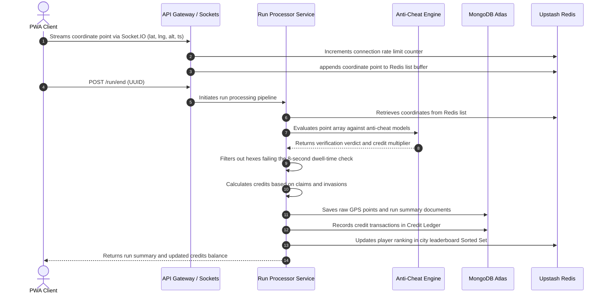

# TerritoryRun (Runnify) — Complete Project Overview & Full Stack Bird's Eye View

> **Author:** Core Engineering Team  
> **Status:** Production-Ready  
> **Target Audience:** CTO, Technical Interviewers, System Designers

---

## 1. Executive Summary & Core Concept

### 1.1 The Problem Space
Traditional fitness applications (like Strava or Nike Run Club) successfully log cardiovascular performance and display list-based leaderboards, but they lack a **sustainable behavioral loop** that keeps non-elite runners engaged long-term. Gamified location apps (like Pokémon GO or Ingress) encourage outdoor activity but are vulnerable to GPS spoofing, require continuous screen interaction while moving (which is unsafe for running), and suffer from "early adopter monopoly" where key spatial points are permanently occupied by veterans.

### 1.2 The TerritoryRun Solution
**TerritoryRun (Runnify)** is a real-world territory-control web application powered by GPS movement. It addresses the limitations of previous systems by combining:
*   **Active GPS Tracking:** The application logs physical movement. Users must run to capture territory, meaning they cannot passively play from their desks.
*   **Geospatial Discretization:** The system maps coordinate streams to discrete grid units using **Uber H3 (Resolution 9)**. This eliminates the need for expensive geometric math and converts spatial containment checks into indexed string matches.
*   **Loss Aversion Mechanics:** The system monitors boundary changes and triggers real-time alerts when a user's claimed grid cells are crossed by another runner. This design leverages loss aversion, encouraging users to run again to defend their territory.
*   **Immutable Performance Anchoring:** To establish trust, the platform aggregates clean daily runs, constructs a Merkle Tree, and anchors the root hash to the **Ethereum Sepolia testnet**. This provides a public, tamper-proof record of verified runs.

---

## 2. High-Level System Architecture Flow

The backend uses a **Modular Monolith** pattern built with Node.js and Express. It manages real-time socket streams, authenticates users, reads maps, and triggers daily game loops. A secondary cluster of lightweight **FastAPI Python services** handles predictive ML calculations, route optimization, and image processing. The frontend is a Progressive Web Application (PWA) built using Next.js 14.

```
                  ┌────────────────────────────────────────┐
                  │          Next.js PWA Client            │
                  └───────────┬────────────────┬───────────┘
                              │                │
                HTTPS Requests│                │Socket.IO Streams
                              ▼                ▼
                  ┌────────────────────────────────────────┐
                  │       Node.js API Gateway (Express)    │
                  └──────┬──────────────────────────┬──────┘
                         │                          │
            Local routing│              HTTP proxies│
                         ▼                          ▼
      ┌──────────────────────────────┐  ┌──────────────────────────────┐
      │     Express Micro-Services   │  │   FastAPI Python Cluster     │
      │  - auth    - run    - map    │  │  - 01 stats   - 03 engagement│
      │  - leader  - chat   - block  │  │  - 06 route   - 11 badge     │
      └──────────────┬───────────────┘  └──────────────────────────────┘
                     │
                     ├──────────────► MongoDB (Mongoose Schema Models)
                     │
                     └──────────────► Upstash Redis (Sorted Sets Cache)
```

### 2.1 Logical Routing Flow
1.  **Ingestion:** The Next.js client initiates a coordinate stream using standard Geolocation API listeners. It establishes a WebSocket link through Socket.IO, streaming coordinates (`lat`, `lng`, `accuracy`, `altitude`, `timestamp`) to the API Gateway.
2.  **Gateway Filtering:** The Express API Gateway manages rate limits and routes traffic. It routes authentication and static map requests locally, while proxying analytical and optimization calculations to the FastAPI Python cluster.
3.  **Caching:** Active leaderboard positions and rate-limit tallies are managed in Upstash Redis, preventing redundant read requests to the main database.
4.  **Storage:** MongoDB Atlas acts as the system of record, storing player profiles, run summaries, claims histories, and audit ledgers.

---

## 3. End-to-End User Lifecycle & Technical Flows

### 3.1 Onboarding & Identity Creation
*   **Initial Map Load:** The visitor opens the PWA. The client requests the current map boundaries from `/api/map/territories`. The server queries MongoDB using a spatial index, returning a list of H3 cell IDs and their associated colors. This allows anonymous users to see active local zones immediately, creating an initial hook.
*   **Identity Setup:** The user selects a username and chooses one of 7 faction colors. The backend writes a new `User` document, generates a unique profile hashcode (e.g., `TR-A94D`), and sets an HTTP-only secure cookie containing a rotating 7-day refresh token.

### 3.2 GPS Tracking & Run Processing Flow
The run tracking and processing flow follows a structured pipeline:



1.  **Coordinate Buffering:** While running, coordinates are validated at the gateway and appended to a temporary list buffer in Redis. This reduces write operations on the database during active runs.
2.  **Session Termination:** When the runner triggers the pause-to-stop slider, the client sends a `POST /run/end` request containing the session UUID.
3.  **Anti-Cheat Assessment:** The Run Processor retrieves the coordinates from Redis and evaluates them against the anti-cheat engine. The engine assesses speed, bearing variance, and pace, returning a verification verdict (`clean`, `warned`, `partial`, or `disqualified`) along with an associated credit multiplier.
4.  **Dwell-Time Filtration:** The system filters out any hex coordinates where the runner spent less than 8 seconds, helping prevent drive-by claiming.
5.  **State Synchronization:** The system updates territory ownership, records transactions in the Credit Ledger, updates leaderboards in Redis, and returns the run summary to the user.

---

## 4. The Credit Economy & Decay Model

The game's virtual economy revolves around **Credits**, representing a player's physical energy and control.

### 4.1 Credit Earning Formula
Credits are awarded automatically at the end of a verified run:

$$\text{Credits Earned} = \left( (\text{Hexes Claimed} \times 10) + (\text{Hexes Invaded} \times 25) \right) \times M_{\text{peak}} \times M_{\text{anticheat}}$$

*   **Hexes Claimed:** Hexes where the runner spent $\ge 8\text{ seconds}$ and which were previously unowned or owned by the same user.
*   **Hexes Invaded:** Hexes claimed from an active rival, which transfers credits from the defender to the attacker.
*   **Peak Multiplier ($M_{\text{peak}}$):** $1.5\text{x}$ during rush hours (06:00–09:00 and 17:00–20:00 local time), encouraging activity during periods of high traffic. Otherwise, $1.0\text{x}$.
*   **Anti-Cheat Penalty ($M_{\text{anticheat}}$):**
    *   `clean` = $1.0\text{x}$
    *   `warned` = $0.75\text{x}$
    *   `partial` = $0.5\text{x}$
    *   `disqualified` = $0.0\text{x}$ (No credits awarded, and no territories claimed).

### 4.2 The Decay Mechanic
To prevent inactive players from dominating the leaderboards indefinitely, the backend executes a decay script daily at 23:59 UTC:

$$\text{Decayed Value} = \text{Hexes Owned} \times (0.98)^{d}$$

*   $d$ represents the number of consecutive days of inactivity.
*   If a player goes 24 hours without uploading a verified run, their total owned hexes count decays by **2%** per day.
*   This decay mechanism encourages consistent activity and helps keep the map dynamic for new players.

### 4.3 Prestige Color Hierarchy
Credits cannot be purchased with real money, securing absolute competitive integrity. Instead, credits are spent to unlock status:
1.  **Selectable Colors:** Neon Green, Electric Blue, Crimson Red, Amber Gold, Magenta, Cyan, Deep Orange.
2.  **Prestige White (`#FFFFFF`):** Unlocked *only* for the user holding the **#1 Rank** in a city. If they drop to #2, the color is locked, and their map cells revert to their previous color selection.
