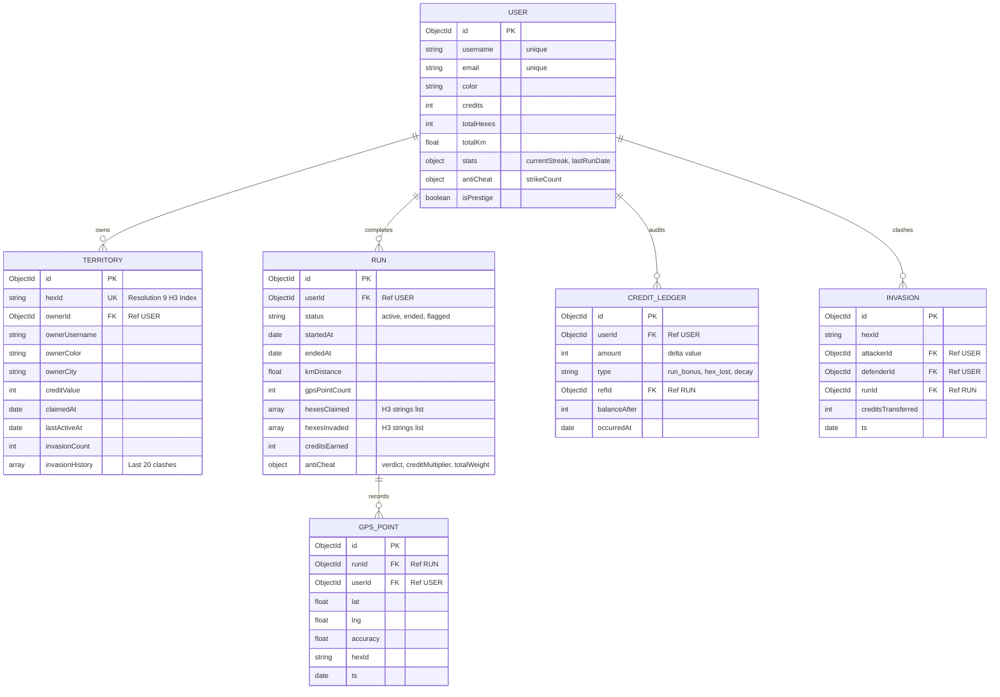

# Backend & System Design Architecture

This document describes the architectural layout, workspace directory structures, database schemas, indexing strategies, cron scheduling pipelines, and security mechanisms of TerritoryRun.

---

## 1. System Architecture Blueprint

TerritoryRun uses a **Modular Gateway Architecture**. External HTTP requests and real-time Socket connections enter through a single gateway router and are forwarded to local decoupled services or proxied to a FastAPI Python microservice bridge.

```mermaid
graph TD
    Client[Web/Mobile Browser PWA] -->|Socket.IO / HTTPS| GW[API Gateway: api-gateway/index.js]
    
    subgraph Express Modular Monolith
        GW -->|Route| AuthS[auth-service/routes.js]
        GW -->|Route| RunS[run-service/routes.js]
        GW -->|Route| MapS[map-service/routes.js]
        GW -->|Route| LbS[leaderboard-service/routes.js]
        GW -->|Route| ChatS[chat-service/routes.js]
        GW -->|Route| BCS[blockchain-service/routes.js]
        GW -->|Route| AI[rag-bot-service/routes.js]
    end

    subgraph Datastores & Cache
        AuthS & RunS & MapS & LbS & ChatS & BCS -->|Mongoose| MongoDB[(MongoDB Atlas Cluster)]
        LbS & RunS & GW -->|ioredis| Redis[(Upstash Redis Cache)]
    end

    subgraph Cron Engine (node-cron)
        CronReset[Daily Reset Cron - 23:59 UTC] -->|Clear Territories + Reward Top 10| MongoDB
        CronAnchor[Blockchain Anchor Cron - 00:00 UTC] -->|Merkle Root to Sepolia| BCS
        CronRAG[RAG Ingest Cron - Every 6h] -->|Update Vector Indexes| AI
    end
```

---

## 2. Directory & Workspace Tree Map

### 2.1 Backend Workspace
```
backend/
├── api-gateway/
│   └── index.js                # System Entry Router, Rate Limiters, Socket Gateway
├── auth-service/
│   ├── routes.js               # OAuth, Registration, Login APIs
│   └── jwt.js                  # Token sign/rotation helper
├── user-service/
│   ├── routes.js               # User statistics, Profiles
│   └── achievements.js         # Seeding, Condition checking, unlocking logic
├── run-service/
│   ├── routes.js               # End Run HTTP triggers
│   ├── socket.handlers.js      # Active tracking socket handlers
│   ├── gps.processor.js        # Valid-checks, anti-cheat execution, ledger writes
│   ├── h3.service.js           # Geo conversions (Res 9), distance calculations
│   ├── anticheat.engine.js     # 6-Layer verification models
│   ├── credit.engine.js        # Dynamic credit rewards, multipliers
│   └── run.model.js            # Mongoose schemas
├── map-service/
│   └── routes.js               # Viewports, bounding-boxes queries
├── leaderboard-service/
│   └── routes.js               # Global/city cached leaderboards, zset queries
├── chat-service/
│   └── routes.js               # Namespaces socket chat structures
├── notification-service/
│   ├── routes.js               # Notifications histories APIs
│   └── push.js                 # WebPush / Socket alert integrations
├── blockchain-service/
│   ├── routes.js               # Proof table fetches, auditors
│   ├── merkle.js               # Trees generators, verification proofs
│   ├── anchor.sync.js          # Daily cron Sepolia contract integration
│   ├── verify.js               # Leaf checks
│   └── proof.model.js          # Mongoose models
├── rag-bot-service/
│   ├── routes.js               # Bot prompt endpoints
│   ├── bot.service.js          # Context inject parser
│   ├── ingest.py               # LangChain loader scripts
│   └── requirements.txt
├── config/
│   ├── db.js                   # Mongoose setup config
│   ├── models.js               # Consolidated schema exporter
│   ├── schema.js               # Base Mongoose schemas definition
│   └── redis.js                # Upstash initialization configs
├── python-services/
│   ├── 01-run-statistics/      # NumPy speed statistics calculator
│   ├── 03-engagement-engine/   # Churn logistics predictors
│   ├── 06-route-optimization/  # NetworkX loops path generator
│   └── start_services.py       # Services runner scripts
└── package.json
```

### 2.2 Frontend Workspace
```
frontend/
├── app/
│   ├── layout.tsx              # Base stylesheet & layouts provider
│   ├── page.tsx                # Entry routing
│   ├── landing/
│   │   └── page.tsx            # Viewport static Leaflet landing page
│   ├── dashboard/
│   │   └── page.tsx            # Glassmorphic KPI counters dashboard
│   ├── run/
│   │   └── page.tsx            # Active tracker with slide-to-stop controls
│   ├── map/
│   │   └── page.tsx            # Leaflet custom styling dark-theme map
│   ├── leaderboard/
│   │   └── page.tsx            # Redis-powered rankings table
│   ├── blockchain/
│   │   └── page.tsx            # Sepolia transactions auditor widget
│   ├── bot/
│   │   └── page.tsx            # LLaMA-3 chatbot layout
│   └── community/
│       └── page.tsx            # Faction namespaces chat panel
├── components/
│   ├── Map.tsx                 # Lazy loaded Leaflet map wrapper
│   └── ui/                     # Glassmorphic component sets
├── tailwind.config.js
└── package.json
```

---

## 3. Database Entity Relationship Diagram (ERD)

Although MongoDB is a document store, we maintain structural relationships between documents.



---

## 4. High-Performance Indexing Strategy

To maintain rapid rendering and high-frequency GPS coordinate writes, MongoDB is tuned with these production indexes:

1.  **Spatial Bounding Queries:**
    *   *Index Target:* Spatial index applied to the geographic coordinates of the center point of each hexagonal territory.
    *   *Mechanism:* Powers viewport fetching. The server queries only the hexes located within the bounding box of the user's active map view, preventing the database from parsing records outside the current viewport.
2.  **Leaderboard Analytics:**
    *   *Index Target:* Compound index on the city field and the credit totals in descending order.
    *   *Mechanism:* Speeds up query times for city-specific dashboards by sorting user credit counts directly at the database engine level.
3.  **GPS Trail Replays:**
    *   *Index Target:* Compound index linking the run session ID to the coordinate sequence timestamps.
    *   *Mechanism:* Hydrates the map coordinate lines sequentially for analysis, ensuring segments are loaded in order.
4.  **Auto-Pruning Indexes (TTL):**
    *   *Index Target:* Time-To-Live index bound to the creation timestamp of temporary data points.
    *   *Mechanism:* Automatically deletes raw coordinate records after 90 days and notification alerts after 30 days. This manages database storage limits and keeps active collections clean.

---

## 5. Security & Rate-Limiting Rules

*   **API Gateway Rate Limiter:** The gateway mounts rate-limiting middleware that monitors requests by IP. If an IP exceeds **1,000 API requests per minute**, subsequent connections are temporarily blocked.
*   **GPS Stream Rate Throttling:** Sockets reject incoming coordinates arriving faster than **once per 3 seconds** or runs exceeding **500 points**. If a tracking run session lasts longer than **4 hours**, the server terminates the socket to prevent infinite tracking loops.
*   **User Sessions Guards:** Restricts users to a maximum of **3 tracking sessions per 24 hours** using a Redis expiry tracker to prevent bot farming.
*   **Credit Ledger Audit Constraints:** The `CreditLedger` database collection is configured with restricted update/delete permissions. Any modifications are snapshot-validated against the user's credits profile to detect anomalies, verifying that the new balance matches the sum of historical ledger entries.
