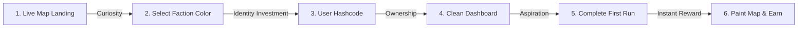

# TerritoryRun — UX Psychology & Gamification Design Manual

This document details the behavioral science principles, habit formation loops, player personas, notification psychology, and ethical guardrails that drive engagement in TerritoryRun (Runnify).

---

## 1. Core Psychological Levers

TerritoryRun leverages three primary cognitive biases to motivate consistent, physical running behavior:

### A. The Endowment Effect (Ownership Bias)
*   **The Science:** Humans value things more once they feel they own them. 
*   **The Implementation:** In TerritoryRun, when a player completes a run, the coordinates they crossed are mapped into hexagons filled with their custom color. It changes a generic map into a personal representation of the player's physical achievements.

### B. Loss Aversion
*   **The Science:** The psychological pain of losing something is twice as powerful as the pleasure of gaining an equivalent item.
*   **The Implementation:** In typical fitness apps, users only gain stats. In TerritoryRun, players can **lose** their territory when another runner crosses it. This loss triggers a drive to defend their turf, prompting them to complete another run to reclaim the coordinates.

### C. Status Signaling (Social Proof)
*   **The Science:** Individuals strive for status within their social group, which is reinforced through visible markers.
*   **The Implementation:** The interactive map acts as a public leaderboard. Having a neighborhood or city landmark colored in a player's color is a status marker visible to all local players.

---

## 2. The Habit Loop Design (The Revenge Loop)

To convert occasional runners into daily active users, we design a structured cycle of triggers, actions, rewards, and investments.

```
       [ TRIGGER ] ────────► Notification: "Your neighborhood has been invaded!"
            ▲                                                                   │
            │                                                                   ▼
       [ INVESTMENT ] ◄─────── [ VARIABLE REWARD ] ◄─────── [ PHYSICAL ACTION ] ◄┘
       Prestige unlocks,       Restored territory,          4km run at 6:30 AM
       rivalry status, points  peak credit bonuses
```

*   **1. The Trigger:** An unpredictable event, such as a push alert indicating that a rival player has claimed a user's hex.
*   **2. The Action:** The user starts the app, presses "Start Run", and runs through the claimed coordinates.
*   **3. The Variable Reward:** The user reclaims their coordinates, sees the map update in their color, and earns credits with potential peak-hour multipliers.
*   **4. The Investment:** The user accumulates credits to unlock customization options or establish a "Named Rivalry" with a competitor.

---

## 3. Player Persona Matrix

We cater to distinct player archetypes, ensuring the app's interfaces appeal to different motivations:

| Persona | Primary Drive | Behavioral Pattern | Key Feature |
|---|---|---|---|
| **The Expander** | Exploration & Growth | Long, slow runs in new neighborhoods to capture territory. | World Map zoom, total claimed hex counters. |
| **The Defender** | Protection & Control | Consistent, daily runs along the same local routes to protect territory. | Push alerts, fast reclaim shortcut on dashboard. |
| **The Rival** | Competition & Dominance | Targeting hexes owned by specific players to spark competition. | Head-to-Head stats tracker, Named Rivalry glowing interface borders. |
| **The Social Player** | Connection & Status | Engaging in chat rooms to coordinate runs or trash-talk. | Color-coded chat, clickable profiles. |
| **The Completionist** | Perfection & Systems | Methodically claiming coordinates to cover a city grid. | Percentage coverage dashboard widget. |

---

## 4. The First 5 Minutes: Onboarding Funnel

To minimize first-session churn, the onboarding flow is designed to quickly build investment:



1.  **Landing Page Hook:** The landing page displays a live map showing active territories. It demonstrates that the game is active without requiring signup.
2.  **Color Selection:** The user selects from 7 faction colors, introducing an immediate identity choice.
3.  **Unique Hashcode:** The app generates a profile hashcode (e.g., `TR-D84A`), establishing an official player identity.
4.  **Dashboard Call-to-Action:** The empty dashboard displays a ghost map of the user's surrounding coordinates with the message: *"This neighborhood could be yours. Start your first run."*
5.  **The First Run:** When the user completes their first short run, their claimed coordinates are colored on the map, reinforcing the core ownership loop.

---

## 5. Notification Architecture & Framing

We frame push alerts to emphasize urgency and loss aversion while respecting user boundaries.

### A. Alert Messaging Layouts
*   **Invasion Alert (Loss-Framed):**
    *   *Message Frame:* Land Seized. Indicates that a rival has claimed a specific count of the user's owned hexes and prompts them to reclaim their territory.
*   **Rank Drop (Status Threat):**
    *   *Message Frame:* Rank Drop. Warns the player when another competitor overtakes their position in the city standings, prompting a run to recover their rank.
*   **Streak Reminder (Loss-Framed):**
    *   *Message Frame:* Streak Danger. Warmly warns when a consecutive activity streak is close to breaking due to inactivity.

### B. Notification Guardrails
To prevent alert fatigue and user churn:
*   **Daily Cap:** Users are restricted to a maximum of **3 push alerts per 24 hours**.
*   **Quiet Hours:** The server suspends non-essential notifications between **23:00 and 07:00** local time.
*   **Privacy Controls:** Users can toggle alerts on or off in their profile settings.

---

## 6. Faction Color Psychology & Status

Colors in TerritoryRun represent a player's identity and status.

*   **Branded Palettes:** Users select from 7 high-contrast colors (Neon Green, Electric Blue, Crimson Red, Amber Gold, Magenta, Cyan, Deep Orange) designed for dark-mode map tiles.
*   **Prestige White:** A custom color unlocked *only* for the **#1 Rank** player in a city. When a player achieves this rank, their claimed hexes turn white on the map. If they lose the top spot, the color locks again, and their hexes revert to their original color. This provides a visible status marker that encourages players to maintain their ranking.

---

## 7. Social Loop Architecture

*   **Status Tiers:** The social loop operates at three levels:
    *   *Global:* Top 100 players worldwide (Aspirational).
    *   *City:* Top 10 in the player's city (Competitive).
    *   *Personal:* Locally tracked rivals (Social).
*   **Namespaced Chat Channels:** Global chat handles general discussions, City chat supports local coordination and friendly competition, and direct messaging allows private communication.
*   **The Named Rivalry Trigger:** When two players claim each other's hexes back and forth 3 or more times in a month, they are designated as "Named Rivals." Their profiles display a head-to-head clash score, and their cells on the map display a glowing crimson border, highlighting their competition.

---

## 8. Ethical Game Design Guardrails

To promote healthy usage habits, we implement these guardrails:
*   **Daily Run Limits:** Users are capped at **3 run uploads per 24 hours**. This limits obsessive behavior and helps prevent overuse injuries.
*   **No Pay-to-Win:** Credits cannot be purchased with real money. They can only be earned through verified physical movement.
*   **Privacy Protections:** The map displays claimed hexagonal grids rather than the user's exact GPS tracking coordinates, protecting their location privacy.
